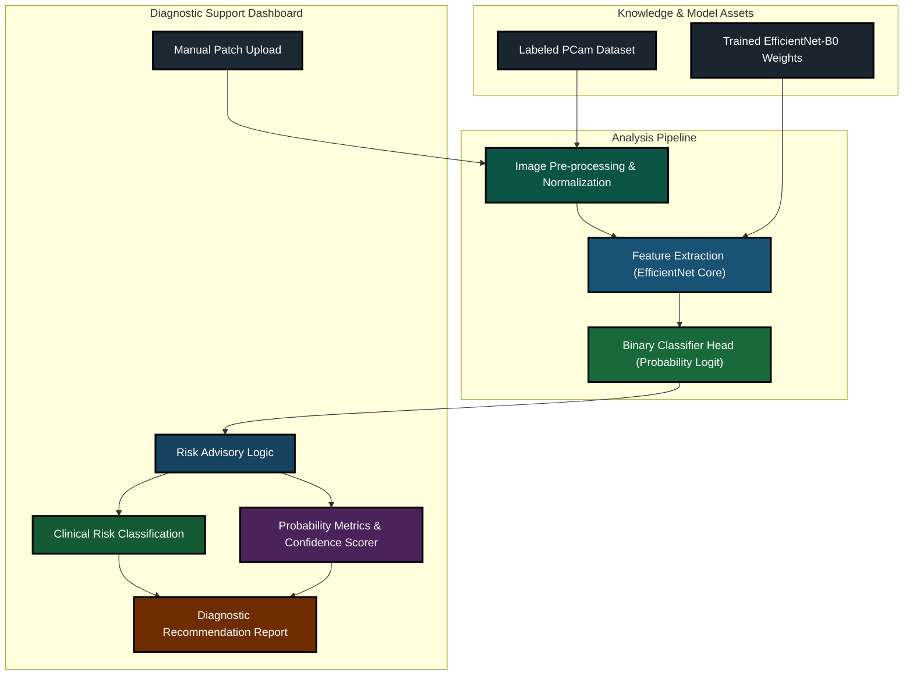

# Cancer Cell Detection - Implementation Architecture (Clean Professional)

This refined architecture follows the structural ground truth of the repository with a high-contrast palette and **Times New Roman** typography, optimized for research publications.

> [!NOTE]
> All labels and group headers are now fully cleaned of parenthetical descriptions. The professional output uses bold, upscaled arrows for better visual weight in printed papers.
